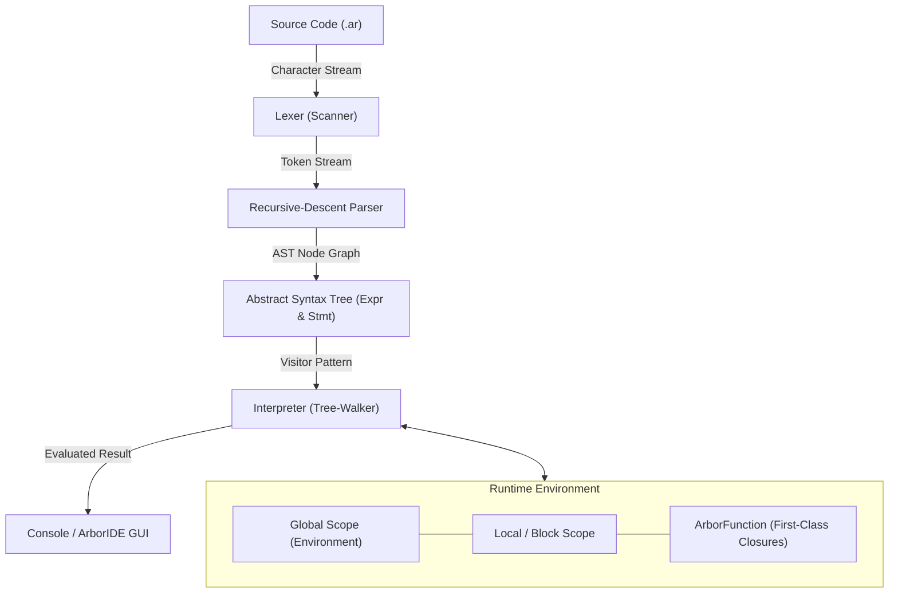

# Arbor (v0.5)

A dynamically typed, interpreted programming language engineered in Java. Arbor features a handwritten lexical scanner, a recursive-descent parser, an Abstract Syntax Tree (AST) evaluated via the Visitor pattern, a hierarchical runtime environment with first-class lexical closures, a command-line script runner, and a built-in Swing mini-IDE.

---

## Architecture Overview

Arbor translates `.ar` source text into runtime values through a classic tree-walk interpreter architecture:



### Component Responsibilities

| Component | Package | Responsibility |
|---|---|---|
| **Lexer** | `com.arbor.lexer` | Scans raw source characters into typed `Token` records with line metadata (`TokenType`). Handles strings, numbers, identifiers, operators, and comments. |
| **Parser** | `com.arbor.parser` | Implements recursive-descent parsing matching Arbor grammar rules. Produces a strongly typed AST (`List<Stmt>`) and performs panic-mode error synchronization. |
| **AST** | `com.arbor.ast` | Hierarchical node classes partitioned into expressions (`com.arbor.ast.expression`) and statements (`com.arbor.ast.statement`), decoupled from evaluation logic via Visitor interfaces (`Expr.Visitor<R>`, `Stmt.Visitor<R>`). |
| **Interpreter** | `com.arbor.runtime` | Evaluates AST nodes by traversing the tree recursively, enforcing runtime type safety, dynamic evaluation, and control flow. |
| **Environment** | `com.arbor.runtime` | Manages variable bindings and lexical scoping through a parent-linked scope chain (`enclosing`), enabling nested blocks and first-class closures. |
| **Callables** | `com.arbor.runtime` | Implements `ArborCallable` and `ArborFunction`, binding declared functions to the lexical environment where they were created. |
| **CLI & GUI** | `com.arbor.cli`, `com.arbor.gui` | Provides dual entry points: a CLI script runner (`Arbor.java`) and a Swing-based interactive IDE (`ArborIDE.java`) with syntax output redirection. |

---

## Language Grammar (EBNF)

Arbor's syntax and operator precedence are formally specified as follows:

```ebnf
program        ::= declaration* EOF ;

declaration    ::= funDeclaration
                 | varDeclaration
                 | statement ;

funDeclaration ::= "fun" IDENTIFIER "(" parameters? ")" "{" statement* "}" ;
parameters     ::= IDENTIFIER ( "," IDENTIFIER )* ;

varDeclaration ::= "let" IDENTIFIER ( "=" expression )? ";" ;

statement      ::= exprStatement
                 | ifStatement
                 | printStatement
                 | returnStatement
                 | whileStatement
                 | block ;

exprStatement  ::= expression ";" ;
ifStatement    ::= "if" "(" expression ")" statement ( "else" statement )? ;
printStatement ::= "print" "(" expression ")" ";" ;
returnStatement::= "return" expression? ";" ;
whileStatement ::= "while" "(" expression ")" statement ;
block          ::= "{" declaration* "}" ;

expression     ::= assignment ;
assignment     ::= IDENTIFIER "=" assignment
                 | equality ;
equality       ::= comparison ( ( "!=" | "==" ) comparison )* ;
comparison     ::= term ( ( ">" | ">=" | "<" | "<=" ) term )* ;
term           ::= factor ( ( "-" | "+" ) factor )* ;
factor         ::= unary ( ( "/" | "*" | "%" ) unary )* ;
unary          ::= ( "!" | "-" ) unary
                 | call ;
call           ::= primary ( "(" arguments? ")" )* ;
arguments      ::= expression ( "," expression )* ;
primary        ::= NUMBER | STRING | "true" | "false" | "null"
                 | "(" expression ")"
                 | IDENTIFIER ;
```

---

## Language Features & Examples

### 1. Variables and Types (`let`)
Variables are dynamically typed and declared using the `let` keyword. Statements are terminated by semicolons:

```javascript
let greeting = "Hello, Arbor!";
let count = 42;
let isValid = true;

print(greeting);
```

### 2. Control Flow (`if` / `else`, `while`)
Arbor supports standard conditional branching and looping:

```javascript
let i = 0;
while (i < 5) {
    if (i % 2 == 0) {
        print("Even number: " + i);
    } else {
        print("Odd number: " + i);
    }
    i = i + 1;
}
```

### 3. Functions & Recursion (`fact.ar`, `fib.ar`)
Functions are declared with `fun` and return values using `return`:

```javascript
// Factorial (fact.ar)
fun fact(n) {
    if (n <= 1) return 1;
    return n * fact(n - 1);
}

print(fact(5)); // Output: 120
```

```javascript
// Fibonacci (fib.ar)
fun fib(n) {
    if (n <= 1) return n;
    return fib(n - 1) + fib(n - 2);
}

print(fib(10)); // Output: 55
```

### 4. First-Class Functions and Closures (`closure.ar`)
Functions are first-class values and capture variables in their enclosing lexical environment:

```javascript
fun makeCounter() {
    let count = 0;

    fun increment() {
        count = count + 1;
        return count;
    }

    return increment;
}

let counter1 = makeCounter();
let counter2 = makeCounter();

print("Counter 1:");
print(counter1()); // 1
print(counter1()); // 2
print(counter1()); // 3

print("Counter 2:");
print(counter2()); // 1
```

---

## Project Structure

```text
com.arbor
├── ast
│   ├── Expr.java                     # Expression AST base class & Visitor interface
│   ├── Stmt.java                     # Statement AST base class & Visitor interface
│   ├── expression
│   │   ├── AssignExpr.java           # Variable reassignment node
│   │   ├── BinaryExpr.java           # Arithmetic & logical binary operator node
│   │   ├── CallExpr.java             # Function invocation node
│   │   ├── GroupingExpr.java         # Parenthesized expression node
│   │   ├── LiteralExpr.java          # Numbers, strings, booleans, null literals
│   │   ├── UnaryExpr.java            # Unary negation & logical not node
│   │   └── VariableExpr.java         # Variable reference node
│   └── statement
│       ├── BlockStmt.java            # Scoped block statement node ({ ... })
│       ├── ExpressionStmt.java       # Expression wrapper statement
│       ├── FunctionStmt.java         # Function declaration node
│       ├── IfStmt.java               # Conditional branch statement
│       ├── PrintStmt.java            # Print statement node
│       ├── ReturnStmt.java           # Return statement node
│       ├── VarStmt.java              # Variable declaration statement node (let)
│       └── WhileStmt.java            # While loop statement node
├── cli
│   └── Arbor.java                    # Main CLI entrypoint (file execution & launcher)
├── error
│   ├── ArborError.java               # Top-level language error base class
│   ├── LexicalError.java             # Unexpected character errors
│   ├── ParseError.java               # Grammar & syntax validation errors
│   └── RuntimeError.java             # Dynamic type & evaluation exceptions
├── gui
│   ├── ArborIDE.java                 # Swing-based desktop editor & runner
│   └── CustomOutputStream.java       # JTextArea stream redirection utility
├── lexer
│   ├── Lexer.java                    # Character scanning & tokenization engine
│   ├── Token.java                    # Immutable token value object with line tracking
│   └── TokenType.java                # Keyword, symbol, and literal token enumeration
├── parser
│   └── Parser.java                   # Recursive-descent parser & panic synchronizer
└── runtime
    ├── ArborCallable.java            # Callable interface for functions
    ├── ArborFunction.java            # User-defined function & closure representation
    ├── Environment.java              # Lexical scope & symbol binding store
    ├── Interpreter.java              # AST visitor implementation & tree-walker
    └── Return.java                   # Unwind control exception for return statements
```

---

## Getting Started

### Prerequisites
- **JDK 17+** (or Java 21)
- **Maven 3.8+**

### Building from Source

```bash
git clone https://github.com/sars-23/Arbor_0.5.git
cd Arbor_0.5
mvn clean compile
```

### Running Scripts via CLI

To execute an `.ar` file directly:

```bash
# Using compiled classes
java -cp target/classes com.arbor.cli.Arbor fact.ar

# Or with Maven exec
mvn exec:java -Dexec.mainClass="com.arbor.cli.Arbor" -Dexec.args="fact.ar"
```

Available example scripts in the root directory:
- `fact.ar` — Recursive factorial calculation
- `fib.ar` — Recursive Fibonacci calculation
- `closure.ar` — Nested functions and lexical environment closures

### Launching the Swing Mini-IDE

Running `Arbor` without arguments launches the built-in desktop IDE:

```bash
java -cp target/classes com.arbor.cli.Arbor
```

- **Top Pane**: Read-only output terminal with standard stream redirection.
- **Bottom Pane**: Multi-line code editor.
- **Execution Shortcut**: Press `Shift + Enter` to execute the code in the editor.

---

## Error Handling & Diagnostics

Arbor cleanly categorizes errors across three distinct phases of execution:

1. **Lexical Errors (`LexicalError`)**: Triggered on unrecognized characters or unterminated string literals, reporting the exact line number.
2. **Parse Errors (`ParseError`)**: Triggered when tokens violate grammar rules. The parser reports informative messages (e.g. `Expect ';' after variable declaration`) and executes panic-mode synchronization to recover at statement boundaries.
3. **Runtime Errors (`RuntimeError`)**: Triggered when operations encounter incompatible operand types (e.g. attempting arithmetic on non-numeric operands) or referencing undeclared variables, preventing invalid state mutations.

---

## Author & Portfolio

**Saransh Singh**  
- **GitHub:** [@sars-23](https://github.com/sars-23)  
- **Portfolio:** [https://sars-23.github.io/saransh-singh-portfolio/](https://sars-23.github.io/saransh-singh-portfolio/)  
- **Email:** [saransh.9822@gmail.com](mailto:saransh.9822@gmail.com)